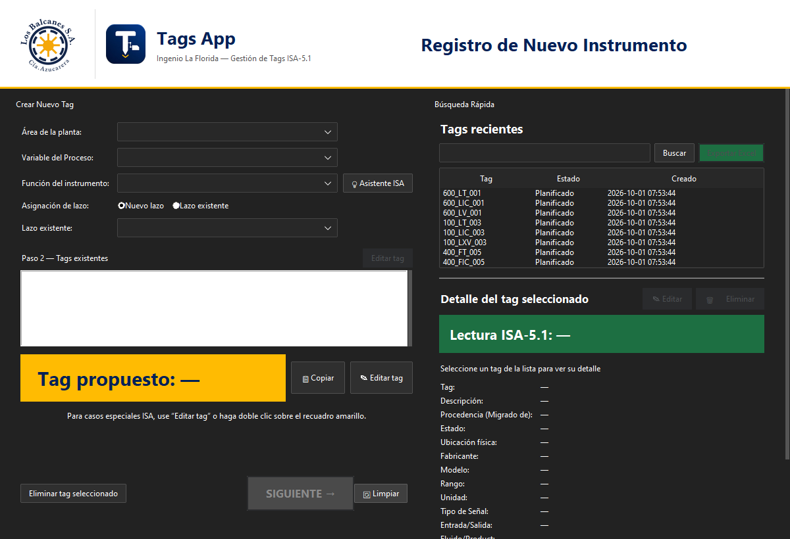
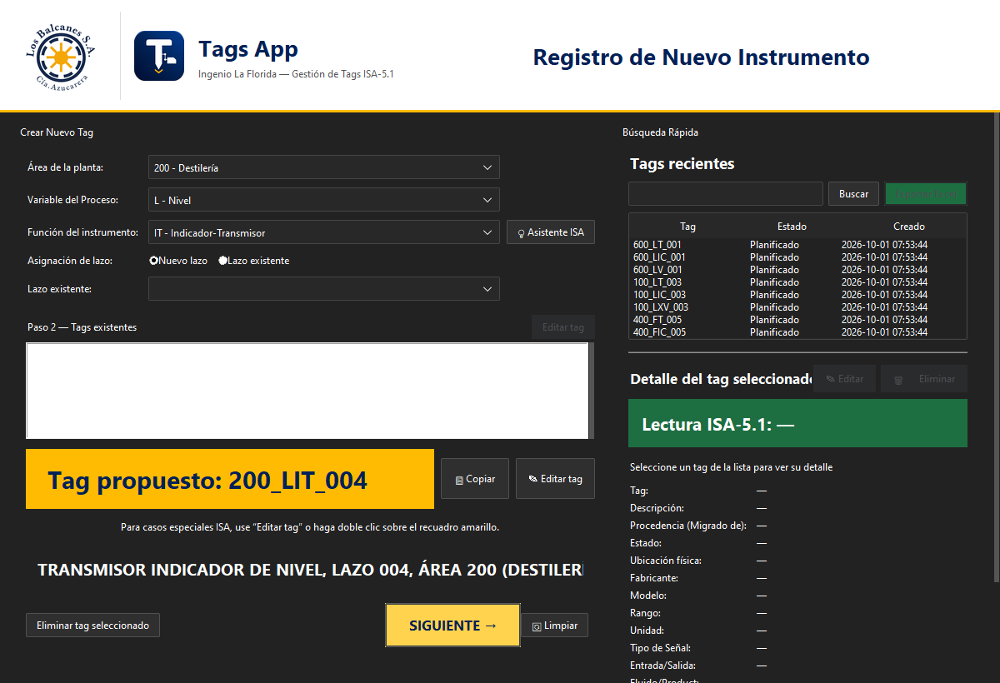
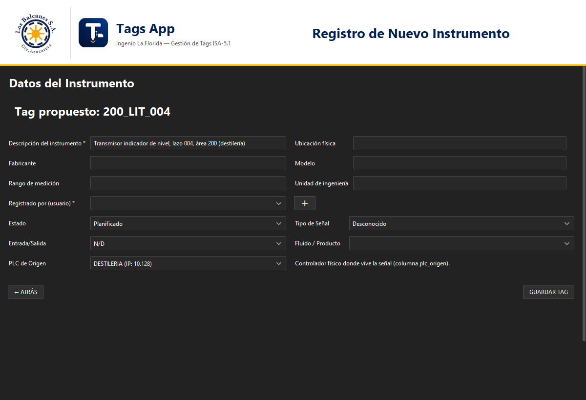

# Catálogo ISA-5.1 — Ingenio La Florida

**Contexto completo del proyecto** · última actualización **20/10/2026**
Documento de traspaso: alcanza para retomar el trabajo sin acceso a las sesiones anteriores.

---

## Índice

1. [Qué es el proyecto](#1-qué-es-el-proyecto)
2. [Estado actual, en una tabla](#2-estado-actual-en-una-tabla)
3. [Cómo se levanta](#3-cómo-se-levanta)
4. [Entorno técnico](#4-entorno-técnico)
5. [Arquitectura de la aplicación](#5-arquitectura-de-la-aplicación)
6. [Modelo de datos](#6-modelo-de-datos)
7. [El catálogo de 381 tags](#7-el-catálogo-de-381-tags)
8. [Historia de los datos: 196 → 478 → 381](#8-historia-de-los-datos-196--478--381)
9. [Reglas de numeración](#9-reglas-de-numeración)
10. [Los 8 canales de revisión](#10-los-8-canales-de-revisión)
11. [Interfaz: cambios de UX del 07/10](#11-interfaz-cambios-de-ux-del-0710)
12. [Empaquetado del .exe](#12-empaquetado-del-exe)
13. [Pruebas](#13-pruebas)
14. [Git y convenciones](#14-git-y-convenciones)
15. [Trampas conocidas](#15-trampas-conocidas)
16. [Pendientes y decisiones abiertas](#16-pendientes-y-decisiones-abiertas)
17. [Glosario ISA-5.1 mínimo](#17-glosario-isa-51-mínimo)
18. [Anexo: artefactos y hashes](#18-anexo-artefactos-y-hashes)

---

## 1. Qué es el proyecto

Una aplicación de escritorio (Tkinter + ttkbootstrap) para **estandarizar y gobernar los tags de instrumentación ISA-5.1** del Ingenio La Florida: los técnicos de planta y mantenimiento dan de alta instrumentos, la aplicación propone el tag según las reglas ISA, lo valida contra el catálogo existente y lo guarda en una base SQLite con auditoría.

El trabajo de fondo de las últimas semanas fue **depurar el catálogo**: de un catálogo inflado con variables eléctricas y de máquina (corrientes, velocidades, vibraciones, temperaturas de bobina, rodamientos, cojines, aceite) a un catálogo **solo de variables de proceso** (nivel, presión, temperatura, caudal, densidad, peso, análisis).

| | |
|---|---|
| Base de datos | `app_etiquetas/tags_ingenio.db` — **381 tags**, 182 lazos, integridad `ok` |
| Aplicación | `app_etiquetas/app_tags.py` (2.569 líneas) + `database.py` (744 líneas) |
| Ejecutable | `C:\Users\Administrador\Desktop\App Tags.exe` (69,0 MiB, logo nuevo) |
| Repositorio | `github.com/agustincuellar-dev/app_tags_estandarization` (rama `main`) |
| Estado del repo | `5c2c78e` — hay cambios de código **sin commitear** (ver §14) |

---

## 2. Estado actual, en una tabla

| Aspecto | Valor |
|---|---|
| Tags | 381, todos en estado `Planificado` |
| Lazos distintos | 182 |
| Áreas con tags | 8 de 12 (000, 800 y 950 vacías) |
| Variables | L 155 · P 105 · T 66 · F 47 · D 5 · W 2 · A 1 — **sin I, S ni V** |
| `plc_origen` | 8 valores, **0 celdas vacías** |
| Auditoría | 4.055 filas |
| Integridad SQLite | `integrity_check = ok`, `foreign_key_check` sin hallazgos, sin `-wal`/`-journal` |
| Tamaño | 1.224.704 bytes |
| SHA-256 (al escribir) | `467b0a2b43e965dc523155e8e27aee6410dd91b8d0fbf44eca78039ebdaf8855` |
| Suite de tests | 234 pruebas en 37 archivos de `tests/` (+11 en `app_etiquetas/test_app_tags_ui.py`), corridas por archivo con Python 3.13 |

> **El SHA de la base cambia al abrir la app**, aunque los datos no cambien. `init_db()` vuelve a ejecutar los `INSERT OR IGNORE` del catálogo ISA, lo que avanza `sqlite_sequence` y reescribe páginas. Comparar tabla por tabla da idéntico. No confundir "bytes distintos" con "datos distintos".

---

## 3. Cómo se levanta

**Aplicación desde el código** (desarrollo):

```bash
C:/Users/Administrador/AppData/Local/Programs/Python/Python313/python.exe app_etiquetas/app_tags.py
```

**Aplicación compilada** (taller): doble clic en `App Tags.exe`. En el Escritorio hay que dejar también la carpeta `app_etiquetas` (hoy es una unión de directorios al proyecto, ver §12).

**Consulta de la base sin riesgo** (solo lectura, patrón usado en todas las auditorías):

```python
c = sqlite3.connect(db.as_uri() + "?mode=ro", uri=True)
c.execute("PRAGMA query_only=ON")
```

Plataforma: Windows 10, terminal del agente en **bash (MSYS)**. `rg` no está disponible: usar `grep` o Python.

---

## 4. Entorno técnico

| Componente | Valor |
|---|---|
| Python de trabajo | **3.13.7** — `C:\Users\Administrador\AppData\Local\Programs\Python\Python313\python.exe` |
| `python` del PATH | 3.11.16 — **no tiene ttkbootstrap**: no sirve para la GUI |
| ttkbootstrap | 2.2.2 |
| PyInstaller | 6.21.0 |
| openpyxl / pandas / Pillow | 3.1.5 / 2.3.3 / 12.3.0 |
| `pytest` | **no instalado** para 3.13 → los tests se corren como `unittest` (`python tests/test_x.py`) |
| Tema | ttkbootstrap `darkly` (legacy; avisa `DeprecationWarning`, se retira en 3.0) |

No hay virtualenv: se usa el intérprete 3.13 directamente.

---

## 5. Arquitectura de la aplicación

```
app_etiquetas/
├── app_tags.py           GUI completa (vistas, estilos, validaciones, export)
├── database.py           único módulo que toca SQLite
├── schema.sql            DDL de las 8 tablas + seeds
├── validador_isa.py      reglas ISA: función permitida por variable
├── tags_ingenio.db       catálogo (NO se empaqueta en el .exe)
├── backups/              24 snapshots nombrados por estado/fecha
└── test_app_tags_ui.py   11 pruebas de la GUI (usan base temporal)
```

### Vistas

`mostrar_vista(nombre)` oculta todas y muestra una: **`inicio`**, **`datos`**, **`busqueda`**. Los widgets se crean una vez y se reutilizan (no se reconstruyen al navegar).

- **Inicio** — selección de Área / Variable / Función, propuesta automática del tag, modo "lazo nuevo" o "sumar a lazo existente", lista de tags de esa categoría, tags recientes con detalle integrado, y el CTA **SIGUIENTE**.
- **Datos del Instrumento** — descripción obligatoria, ubicación, fabricante, modelo, rango, unidad, usuario, estado, tipo de señal, E/S, fluido, **PLC de Origen**, y los botones ATRÁS / GUARDAR TAG (o *Actualizar* en modo edición).
- **Búsqueda expandida** — grilla completa con filtro en vivo, selección múltiple (Ctrl/Shift), export a Excel.

### Flujo de guardado

`on_guardar()` es **la única función autorizada a escribir** en la base (así lo dice su docstring). Valida propuesta, usuario y descripción; confirma con un diálogo; llama a `db.crear_tag(...)`; limpia el formulario; refresca listas; vuelve a Inicio. La edición va por `_entrar_modo_edicion()` → `on_actualizar()` → `db.actualizar_tag(...)`, que **no** permite tocar la identidad ISA (tag, área, variable, función, número de lazo).

### Estilos propios (definidos en `__init__`)

| Estilo | Uso |
|---|---|
| `SiguienteCTA.TButton` | CTA del Paso 1 (ámbar `#FFBB02`, texto `#002157`, negrita 13, padding 26×12) |
| `PropuestaTag.TLabel` | recuadro grande con el tag propuesto (ámbar) |
| `LecturaTag.TLabel`, `IsaReading.TLabel` | lectura humana del tag en verde `#1D6F42` |
| `RecentExport.TButton` | export de la lista de recientes |
| `Recent.Treeview`, `Expanded.Treeview` | grillas oscuras con selección azul |

Paleta: `AZUL #002157`, `AMBAR #FFBB02`, `VERDE_CONFIRMA #1B8A3B`, `ROJO_PELIGRO #B00020`.

---

## 6. Modelo de datos

Ocho tablas (`schema.sql`):

| Tabla | Filas | Para qué |
|---|---|---|
| `tags` | 381 | el catálogo (23 columnas) |
| `areas` | 12 | códigos 000…950 con nombre y rango |
| `variables` | 7 en uso (15 total) | letra ISA + nombre |
| `funciones` | 29 | TT, FT, LIC, FV, … |
| `usuarios` | 7 | Agustin, ariel, diego, jesus, oscar, ricardo, yanco |
| `auditoria` | 4.055 | traza de cada alta/modificación/baja |
| `reglas_aprendidas` | 10 | patrones de clasificación automática por PLC |
| `tags_no_clasificados` | 1.497 | staging del motor de auditoría de L5X (no es catálogo) |

### `tags` — columnas que importan

| Columna | Semántica |
|---|---|
| `tag_completo` | identidad ISA: `AREA_VARFUNC_NNN` (+ sufijo `A`/`B`). **UNIQUE** |
| `area_id`, `variable_id`, `funcion_id`, `numero_loop` | descomposición de la identidad; `numero_loop` es del **lazo**, no del instrumento |
| `descripcion` | obligatoria en la UI |
| `plc_origen` | controlador físico. 8 valores canónicos (ver §7) |
| `alias_for` | dirección/alias original del L5X (`Local:2:I.Ch[4].Data`) |
| `comentarios` | procedencia, notas de migración ("Migrado de: …") |
| `tipo_senal` | `Analógico` / `Digital` / `Desconocido` |
| `entrada_salida` | `Entrada` / `Salida` / `Memoria / Red` / `N/D` |
| `fluido_proceso` | producto que maneja el instrumento |
| `estado` | `Planificado` / `Instalado` / `Fuera de Servicio` / `Retirado` |
| `datatype` | tipo del PLC (REAL/BOOL/INT…) |

`auditoria.accion` ∈ `CREACION` · `MODIFICACION` · `ACTUALIZACION` · `ELIMINACION`, con `detalle` y `usuario`. Toda escritura hecha por el agente también dejó su fila de auditoría.

---

## 7. El catálogo de 381 tags

### Por área

| Código | Área | Tags |
|---|---|---|
| 000 | Recepción y Preparación de Caña (Desfibrador) | 0 |
| 100 | Molienda | 24 |
| 200 | Destilería | 117 |
| 250 | Biodestilería | 13 |
| 300 | Calderas / Generación de Vapor | 87 |
| 400 | Clarificación y Encalado | 18 |
| 500 | Evaporación | 50 |
| 600 | Cocimiento / Tachos | 15 |
| 700 | Centrifugado / Purga | 48 |
| 800 | Secado y Envase | 0 |
| 900 | Fuerza Motriz / Turbogeneradores | 9 |
| 950 | Tratamiento de Agua / Ósmosis | 0 |

### Por PLC (`plc_origen`, valores canónicos)

| Valor | Tags | IP (inventario verificado) |
|---|---|---|
| `FABRICA` | 131 | 192.168.10.118 / .119 (redundante) |
| `DESTILERIA` | 109 | 192.168.10.128 |
| `Calderas_8_9_10_Desaireador` | 75 | 192.168.10.195 / .196 |
| `TRAPICHE2022` | 24 | 192.168.10.99 |
| `cenizas2020` | 18 | 192.168.10.126 |
| `DIBACCO` | 13 | 192.168.10.170 |
| `USINA_LA_FLORIDA` | 9 | 192.168.10.13 |
| `CALD_LA_FLORIDA` | 2 | 192.168.10.251 / .252 |

Otras IPs del inventario que no tienen tags todavía: `CENTRIFUGA_DE_PRIMERA` (.50), `Painel_Ctr_Turb_Moenda` (.174), `LA_FLORIDA` (.160).

**Regla:** el valor que se guarda es el texto canónico de esta tabla; la UI muestra `NOMBRE (IP: 10.xxx)` pero persiste sólo el nombre — así no se crean variantes nuevas.

### Reglas ISA aplicadas

- No se repite número de lazo con otra variable: un lazo `NNN` agrupa transmisor + controlador + válvula/indicador.
- `validador_isa.py` restringe qué función admite cada variable (`funciones_permitidas_para_variable`).
- No se inventan instrumentos: todo tag nuevo tiene que salir de una señal real del L5X o de una decisión explícita del usuario.

---

## 8. Historia de los datos: 196 → 478 → 381

| Fecha | Estado | Artefacto |
|---|---|---|
| ≤ 18/09 | 196 tags de producción | `backups/tags_ingenio_pre_v5_196tags_290926.db` (aud. 3.763) |
| 29/09 | cadena de planes v1→v5: 334 → 358 → 417 → 465 → **478** | `exports/plan_maestro_consolidado_v5_290926.csv` |
| 29/09 | homologación de estados: 722 filas, 349 operaciones activas, 0 `REVISAR` | `exports/plan_maestro_consolidado_v5_homologado_290926.csv` |
| 29/09 | migración 196→478 (294 INSERT, 43 UPDATE, 12 DELETE) y **defecto del `alias_for`** detectado y corregido restaurando el backup | `src/migrar_plan_v5_a_produccion_290926.py` |
| 30/09 | otra sesión consolida el estado de 478 (commit `f44a657`) | — |
| 01/10 | **depuración "puro proceso"**: 99 bajas + 2 altas → **381** | `exports/plan_maestro_puro_proceso_290926.csv`, `src/generar_plan_puro_proceso_290926.py`, `src/aplicar_plan_puro_proceso_290926.py` |
| 01/10 | `plc_origen`: 14 altas sin PLC y luego los 11 manuales | `backups/…pre_plc_origen*.db` |
| 01/10 | unificación de strings de PLC (15 filas: `Calderas_8_9_10_Des` y `DESTILERIA_16062026`) | commit `5c2c78e` |

### La depuración "puro proceso" (el paso que definió el catálogo actual)

Se aplicó sobre el plan homologado, en una transacción única, restaurando primero la base de 196:

1. **Fuera los instrumentos electromecánicos** (variable I/S/V): 50 de corriente + 34 de velocidad + 1 de vibración = **85 filas**.
2. **Fuera los mecánicos de T/P** cuya identidad menciona MOTOR, BOBINA, ROD_, CCM, COJINETE, ACEITE o AXIAL: **14 filas** (rodamientos y bobina de motor en Trapiche, lubricación/cojín/axial de la Usina, CCM).
3. **Dentro los dos caudalímetros de proceso de Trapiche** que estaban trabados por alias viejos: `Local:3:I.Ch2Data` (vapor desfibrador) y `Local:3:I.Ch4Data` (agua de lavado de tamices).
4. **Renumeración** de los INSERT que quedaron (ver §9).

Balance: `196 + 197 INSERT − 12 DELETE = 381`. Auditoría: +252 filas.

### Los 11 tags manuales (candado)

Creados a mano antes del proyecto, sin `plc_origen`, y protegidos campo a campo durante todas las migraciones:

```
200_PIT_004  200_PIC_004  200_PV_004
200_LT_035   200_LIC_035  200_LV_035
200_FT_080   200_FIC_080  200_FV_080
250_PV_001   250_PV_002
```

El 01/10 se les completó **sólo** `plc_origen` (9 → `DESTILERIA`, 2 → `DIBACCO`) con autorización explícita, en una transacción con auditoría. Cualquier otro cambio sobre ellos requiere autorización nueva.

---

## 9. Reglas de numeración

Son la parte más delicada del proyecto. Resumen operativo:

1. **El número pertenece al lazo.** `300_LT_049`, `300_LIC_049` y `300_LV_049` comparten el 049 porque son el mismo lazo físico.
2. **Los números de producción no se tocan.** Toda propuesta se valida contra los lazos existentes antes de asignar.
3. **Sufijos `A`/`B`** distinguen instrumentos del mismo tipo dentro del mismo lazo (domos, ramas).
4. **INSERT que extiende un lazo existente** conserva el número del lazo (11 filas del plan v5). **INSERT que crea lazo nuevo** puede renumerarse.
5. **Renumeración compacta:** al eliminar instrumentos quedan huecos; los lazos nuevos se reasignan a los números libres más bajos de cada área, sin tocar los lazos de producción. En la depuración del 01/10 se renumeraron **125 de 186 grupos**; el mapeo completo está en `exports/remap_numeracion_puro_proceso_290926.csv` y cada fila del plan guarda `Tag_PreFiltro`.
6. **No se reciclan números retirados** (bajas por consolidación o renombre) mientras la base esté en construcción; la regla se vuelve estricta con la puesta en producción con operarios.
7. **Huecos que quedan:** los de cada área vienen de números que la base **nunca usó** (ej. área 100 usa 1–7 y 29, 31–34). Cerrarlos exigiría renumerar los 381 tags de producción: no se hace.

---

## 10. Los 8 canales de revisión

Ocho canales del PLC con identidad contradictoria (dos nombres para la misma señal). Documentados en `00_REVISION_STUDIO5000_HOY/GUIA_8_CANALES_A_REVISAR.md` (+ `.txt` para imprimir), con los tres `.ACD` copiados al lado para abrirlos en Studio 5000.

| # | PLC / canal | Estado |
|---|---|---|
| 1 | TRAPICHE `Local:2:I.Ch5Data` — ¿IT bomba de imbibición o ST turbina 2º molino? | **pendiente** |
| 2 | TRAPICHE `Local:3:I.Ch2Data` — vapor desfibrador | **resuelto** → `100_FT_006` |
| 3 | TRAPICHE `Local:3:I.Ch4Data` — agua lavado tamices | **resuelto** → `100_FT_007` |
| 4 | TRAPICHE `Local:9:I.Ch[1].Data` — Pt100 bobina de motor | **fuera de alcance** (BOBINA/MOTOR) |
| 5 | DESTILERIA `jw_fermerntacion_2022:2:I.Ch2Data` — ¿ST centrífuga 3 o TT enfriador de alcohol? | **pendiente** |
| 6 | DESTILERIA `jw_fermerntacion_2022:2:I.Ch4Data` — ¿ST centrífuga 5 o TT calentador de vino? | **pendiente** |
| 7 | DESAIREADOR `Desaireador:3:I.Ch[5].Data` — dos bloques SCL vivos (velocidad 0–1500 RPM y temperatura 0–150 °C) + alias de corriente | **pendiente** |
| 8 | DESAIREADOR `Desaireador:3:I.Ch[1].Data` — alias de velocidad sin bloque que lo lea | **fuera de alcance** (`_ST_`) |

Para DESTILERIA hay además una guía de una sola pregunta: `GUIA_DESTILERIA.txt`.

**Advertencia sobre los ACD:** los tres son copias para inspección, no originales, y son **anteriores** a los L5X auditados (TRAPICHE es un `.BAK031` del 30/07; DESTILERIA un `DESTILERIA_RECUPERADO.ACD` del 05/08; Calderas del 15/07 frente al L5X del 18/08). Verificar versión al abrirlos antes de usarlos como fuente definitiva.

---

## 11. Interfaz: cambios de UX del 07/10

Dos cambios pedidos para el taller, ya en el código y en el `.exe`:

### 11.1 SIGUIENTE como acción principal

Estilo `SiguienteCTA.TButton`: fondo ámbar corporativo `#FFBB02`, texto azul `#002157`, negrita 13 pt, padding 26×12 (más grande que *Limpiar* y *Eliminar*), hover `#FFD34D`, click `#E0A400`. **Deshabilitado vuelve a gris `#4A4A4A`**: el color avisa si hay propuesta válida o no. ttk no hace esquinas realmente redondeadas; el destaque es por color, tamaño y peso.

| Deshabilitado | Habilitado |
|---|---|
|  |  |

### 11.2 Selector "PLC de Origen" en Datos del Instrumento

Combobox `readonly` con 10 controladores, formato `NOMBRE (IP: 10.xxx)`, leyenda "Controlador físico donde vive la señal (columna plc_origen)". Persiste el **valor limpio** en `tags.plc_origen`; al editar precarga el PLC del tag; al limpiar el formulario se vacía. Es opcional (no bloquea el guardado), igual que el resto de los campos del Paso 2.



**Persistencia:** `database.crear_tag()` y `database.actualizar_tag()` recibieron el parámetro `plc_origen` y la columna en el INSERT/UPDATE. Antes de este cambio la app **no guardaba** ese campo.

**IPs:** salen de `IP_POR_PLC` en `app_tags.py`, tabla documentada como verificada contra `data_historica/inventario_plcs_*.xlsx` y contrastada con los .L5X (TRAPICHE `.99`, cenizas `.126` y Calderas `.195` coinciden con lo declarado en cada L5X). Las IPs que circulan de memoria (10.110, 10.105, 10.115, 10.120, 10.140) **no** son las del inventario.

### 11.3 Logo nuevo (20/10/2026)

El master es `app_etiquetas/logoo nuevo.png` (1264×1264, render con fondo claro y sombra). Para usarlo se generaron, con `PIL`:

| Archivo | Uso |
|---|---|
| `logo_app_tags.png` (512×512, fondo transparente) | master del encabezado; la app lo reduce a 60×60 con LANCZOS |
| `logo_app_tags.ico` (16…256) | icono de ventana (`_aplicar_identidad`) |
| `app_tags.ico` (16…256) | icono alternativo / `--icon` del `.exe` |

El PNG se recortó al cuerpo del badge (se detectó el azul profundo), se le aplicó una máscara de cuadrado redondeado con el radio medido del original (≈21,5 % del lado, 213 px sobre 991) y así se eliminó la sombra del render; sin la máscara quedaba un halo gris visible sobre fondos oscuros.

En el **encabezado** el logo nuevo reemplazó a las dos variantes anteriores: el icono chico que estaba antes del logo corporativo y el esquema ISA que acompañaba el texto. Queda un solo lockup: `[Los Balcanes] │ [badge] Tags App / Ingenio La Florida — Gestión de Tags ISA-5.1` y el título a la derecha.


Si se cambia el master, hay que regenerar los tres archivos y **recompilar**: el `.exe` lleva el `.ico` embebido, y el encabezado necesita `logo_app_tags.png` entre los `--add-data`.

---

## 12. Empaquetado del .exe

### 12.1 Qué resuelve el empaquetado

El `.exe` es un solo archivo (`--onefile`, `--noconsole`) y **no lleva la base adentro**: al congelarse, `__file__` apunta a una carpeta temporal, así que la base tiene que resolverse desde la carpeta del ejecutable. Un *runtime hook* fija `database.DB_PATH` antes de que `app_tags` importe nada, y si no encuentra la base **avisa y sale** en vez de crear un catálogo vacío.

Orden de búsqueda:

1. `<carpeta del exe>\app_etiquetas\tags_ingenio.db` (disposición portable)
2. `<carpeta del exe>\tags_ingenio.db` (exe y base sueltos)

### 12.2 Hook (guardar como `runtime_db_externa.py`)

```python
import ctypes, os, sys
import database

carpeta_exe = os.path.dirname(os.path.abspath(sys.executable))
candidatas = [
    os.path.join(carpeta_exe, "app_etiquetas", "tags_ingenio.db"),
    os.path.join(carpeta_exe, "tags_ingenio.db"),
]
elegida = next((r for r in candidatas if os.path.isfile(r)), None)

if elegida is None:
    ctypes.windll.user32.MessageBoxW(
        0,
        "No se encontró la base de datos del catálogo.\n\n"
        f"Se buscó en:\n  1) {candidatas[0]}\n  2) {candidatas[1]}\n\n"
        "Copie la carpeta 'app_etiquetas' junto al ejecutable.\n"
        "No se creó ninguna base nueva para no arriesgar los datos.",
        "Catálogo La Florida - falta la base", 0x10)
    sys.exit(1)

database.DB_PATH = elegida
```

### 12.3 Comando de compilación

```bash
pyinstaller --noconfirm --clean --noconsole --onefile --name "App Tags" \
  --collect-data ttkbootstrap \
  --runtime-hook runtime_db_externa.py \
  --add-data "app_etiquetas\schema.sql;." \
  --add-data "app_etiquetas\logo_app_tags.png;." \
  --add-data "app_etiquetas\logo_balcanes.png;." \
  --add-data "app_etiquetas\logo_app_tags.ico;." \
  --add-data "app_etiquetas\app_tags.ico;." \
  --icon app_etiquetas\app_tags.ico \
  --workpath C:\temp\build --distpath C:\temp\dist --specpath C:\temp\spec \
  app_etiquetas\app_tags.py
```

Tres detalles que no son opcionales:

- **`--collect-data ttkbootstrap`**: sin la fuente `bootstrap.ttf` la app muere al arrancar.
- **`--add-data …;.`** (punto, no `app_etiquetas`): el código lee `schema.sql` y los logos desde `BASE_DIR`, que en el `.exe` es la raíz temporal. Con `;app_etiquetas` falla con `No such file or directory: …\schema.sql`. El `logo_app_tags.png` es imprescindible: es el que dibuja el encabezado.
- **`--icon`**: el `.ico` tiene que ser multi-tamaño. `app_tags.ico` y `logo_app_tags.ico` se generan con 16/24/32/48/64/128/256 desde el PNG master de 512 px.

El ícono del ejecutable es el **logo nuevo**: badge azul profundo con la T blanca terminada en pluma, el símbolo de válvula y el chevrón ámbar. Es el mismo que la app usa como icono de ventana (`_aplicar_identidad` → `logo_app_tags.ico`) y el que se dibuja en el encabezado (§11.3).

### 12.4 Dónde está y cómo se despliega

- Hoy: `C:\Users\Administrador\Desktop\App Tags.exe` (72.379.526 bytes / 69,0 MiB).
- Junto a él, `app_etiquetas` en el Escritorio es una **unión de directorios** (`mklink /J`) al `app_etiquetas` del proyecto: el `.exe` la ve como carpeta normal y escribe en la **misma** base. No es una copia; verificado por inodo y SHA.
- **Para el taller**: copiar el `.exe` **y la carpeta `app_etiquetas` real** (la unión no viaja). Sin la base al lado, el `.exe` avisa y no arranca.
- Sin firma digital: la primera vez en otra PC, SmartScreen → *Más información → Ejecutar de todas formas*.
- La app en el `.exe` escribe su base en `<carpeta del exe>\app_etiquetas\tags_ingenio.db`; los export de Excel que dispare el usuario van a `<carpeta del exe>\app_etiquetas\exports\` (también temporal si se empaquetó, ver §15).

---

## 13. Pruebas

No hay `pytest` para 3.13: cada archivo se corre como script.

```bash
PY=C:/Users/Administrador/AppData/Local/Programs/Python/Python313/python.exe
$PY tests/test_plc_selector_paso2.py     # 5 pruebas: CTA + selector de PLC + persistencia
$PY app_etiquetas/test_app_tags_ui.py    # 11 pruebas de la GUI (base temporal propia)
$PY tests/test_clear_creation_form.py    # reset del formulario (test de fuente)
$PY tests/test_phase3_navigation.py      # vistas y acciones presentes
$PY tests/test_loop_ui_integration.py    # integración de lazo en la UI
```

**Patrón obligatorio para pruebas con base**: copiar `tags_ingenio.db` a un temporal, apuntar `database.DB_PATH` a esa copia **antes** de instanciar la ventana, y monitorear los diálogos (`app_tags.messagebox.askyesno = lambda *a, **k: True`). Nunca correr una prueba que escriba contra producción.

`tests/test_plc_selector_paso2.py` se salta solo (`skipUnless`) si el intérprete no tiene ttkbootstrap, para no romper la suite con el Python del PATH.

---

## 14. Git y convenciones

| | |
|---|---|
| Remoto | `https://github.com/agustincuellar-dev/app_tags_estandarization.git` |
| Rama | `main` (HEAD = `origin/main` = `5c2c78e`) |
| Últimos commits | `5c2c78e` strings de plc_origen · `fd5acc8` 381 tags + metadatos · `f44a657` estandarización · `eed2b10` 196→478 |

**Qué se versiona**

- ✅ `app_etiquetas/*.py`, `schema.sql`, **`tags_ingenio.db`** y `app_etiquetas/backups/*.db`, `src/*.py`, `docs/*`, guías de `00_REVISION_STUDIO5000_HOY/`, y (forzados) `exports/plan_maestro_puro_proceso_290926.csv` + `exports/remap_…csv`.
- ❌ `exports/` en general, `build/`, `dist/`, `__pycache__/`, `*.log`.
- ❌ Binarios pesados por `.gitignore`: `*.ACD`, `*.BAK`, `*.L5X`, `*.zip`, `*.rar`, `*.exe`, `*.iso`, y las carpetas `archivo_ordenado/`, `ACD_Para_Convertir/`, `p pasar/`, `data_historica/`, `L5X_Produccion/`, `archivo… auditados/`, DVD de Studio 5000, Matlab, etc. **Sin eso, un `git add -A` intenta subir ~5 GB.**

**Regla de staging:** agregar rutas explícitas, nunca `git add -A`. Verificar con `git check-ignore -v` cuando haya duda.

**Estado ahora mismo:** `app_tags.py`, `database.py` y `tags_ingenio.db` están modificados y **sin commitear** (los cambios de UX del 07/10 y el llenado de `plc_origen`). Además **`tests/` entero está fuera de git** (0 archivos trackeados): el test nuevo no viajaría salvo que se agregue explícitamente.

---

## 15. Trampas conocidas

| Trampa | Detalle / cómo se evita |
|---|---|
| `alias_for` truncado | Una primera expresión regular cortaba la dirección al llegar a `[` (`Ch` en vez de `Ch[4].Data`). Se corrigió a `[A-Za-z_][A-Za-z_0-9]*:\d+:[IO](?:\.[A-Za-z_0-9\[\]]+)+` y se rehizo la migración **restaurando el backup**, no parcheando en caliente. |
| Bytes cambian sin datos | `init_db()` reejecuta seeds (`INSERT OR IGNORE`) → `sqlite_sequence` avanza y el archivo se reescribe. Comparar contenido, no SHA, cuando se dude. |
| `sqlite3.connect(as_uri())` con ruta relativa | `Path.as_uri()` exige absoluta: `resolve()` antes, o `ValueError: relative path can't be expressed as a file URI`. |
| Python del PATH | 3.11 sin ttkbootstrap → la GUI no arranca. Usar siempre el 3.13. |
| `.exe` sin `schema.sql` | Si se agrega con `;app_etiquetas` en vez de `;.`, muere al inicio. |
| `.exe` sin base | Con el hook avisa y sale; **sin** el hook crearía una base vacía (el `_resolver_db_path` copia la base empaquetada sólo si existe; si no, devuelve la ruta y `init_db()` crea tablas vacías). |
| `--noconsole` oculta errores | Un fallo al arrancar muestra un diálogo "Unhandled exception in script": hay que leerlo con `EnumWindows`/`GetWindowText` o compilar con consola para depurar. |
| PyInstaller onefile | Lanza **dos procesos** (padre e hijo): al matar, enumerar descendientes o queda huérfano. |
| Tests con conteos fijos | Varias pruebas fijan `478` tags por igualdad estricta: si se corren contra el catálogo actual (381) fallan por diseño, no por regresión. |
| CRLF | Los archivos del repo están en CRLF; `patch`/`write_file` avisan "LF will be replaced by CRLF". No es un problema, pero evita diffs masivos si se normaliza. |
| Caracteres especiales en rutas | El proyecto tiene carpetas con espacios y `ñ`; en bash hay que citar (`"p pasar/"`). |
| `rg` no instalado | Usar `grep -rn` o Python para buscar en el código y en los L5X. |
| Comentarios con numeración vieja | El código dice "Paso 3" para el formulario de datos y tiene `refrescar_paso5()`; la UI muestra "Paso 1" y "Paso 2". No guiarse por esos nombres. |

---

## 16. Pendientes y decisiones abiertas

### Datos

1. **4 canales sin definir** (§10, canales 1, 5, 6 y 7). Requieren abrir el `.ACD`/tablero y confirmar qué está cableado. No crear tags sin esa confirmación.
2. **`CALD_LA_FLORIDA` (2 tags) vs `Calderas_8_9_10_Desaireador` (75)**: podrían ser el mismo PLC con otro nombre de proyecto. No se unificó porque `CALD_LA_FLORIDA` es el nombre de un `.ACD` distinto y puede ser intencional.
3. **IPs a confirmar**: DIBACCO (`.170`), USINA (`.13`), CALD_LA_FLORIDA (`.251/.252`) no se pudieron contrastar contra el L5X; salen del inventario en Excel.
4. **Áreas 000, 800 y 950 vacías**: la 000 quedó sin tags tras consolidar los lazos de recepción de caña (los 6 tags de 000_…_009 y _016 se eliminaron y uno se renombró a 250). Si el desfibrador debe tener catálogo propio, hay que decidirlo.
5. **1.497 filas en `tags_no_clasificados`** (staging del motor de auditoría de L5X): no son catálogo. Decidir si se depuran, se reclasifican o se archivan.

### Código y repo

6. **Commit pendiente** de `app_tags.py`, `database.py` y la base; y decidir si se trackea `tests/`.
7. **`App Tags.exe`** está compilado con el código nuevo, pero si se cambia una línea hay que recompilar (§12.3).
8. **Barra de título**: dice "Tags App - Gestión de Tags ISA-5.1"; si se quiere "App Tags", es una línea + recompilar.
9. **Acceso viejo en el Escritorio**: `app_tags - Acceso directo.lnk` apunta al `.py` con icono genérico de Python. Redundante; conviene borrarlo o repuntarlo al `.exe`.
10. **Export de Excel en el `.exe`**: `app_tags.py` arma la carpeta `exports` a partir de `__file__` (hoy en las líneas 1430 y 2352); en el `.exe` eso cae en la carpeta temporal y el archivo puede perderse al cerrar. Si el taller va a exportar, hay que redirigirlo a `os.path.dirname(sys.executable)/exports` o a Documentos.
11. **Tema `darkly`** es legacy en ttkbootstrap 2.2 (se retira en 3.0): a futuro hay que migrar a un tema 2.0.

---

## 17. Glosario ISA-5.1 mínimo

- **Tag** = `AREA + VARIABLE + FUNCIÓN + NÚMERO DE LAZO`. Ej.: `300_LIC_049` = área 300, variable L (nivel), función IC (controlador indicador), lazo 049.
- **Variables usadas**: L nivel · P presión · T temperatura · F caudal · D densidad · W peso/fuerza · A análisis. (I corriente, S velocidad y V vibración quedaron fuera por la depuración de proceso.)
- **Funciones**: T transmisor · IT transmisor indicador · C controlador · IC controlador indicador · V válvula · XV válvula todo/nada · I indicador · R registrador · S switch · G mirilla.
- **Lazo**: conjunto sensor–controlador–actuador que comparte número.
- **Sufijo A/B**: dos instrumentos del mismo tipo en el mismo lazo.

---

## 18. Anexo: artefactos y hashes

### Backups relevantes (`app_etiquetas/backups/`)

| Archivo | Contenido | Tags | Aud. | SHA-256 (inicio) |
|---|---|---|---|---|
| `tags_ingenio_pre_v5_196tags_290926.db` | producción antes de la migración v5 | 196 | 3.763 | `dc4d9c212588…` |
| `tags_ingenio_478tags_antes_puro_proceso_010926.db` | estado de 478 antes de depurar | 478 | 4.112 | `bb94eb628adf…` |
| `tags_ingenio_381tags_pre_plc_origen_011026.db` | 381 con 25 PLC vacíos | 381 | 4.015 | `28c9b8922cb8…` |
| `tags_ingenio_381tags_pre_plc_origen_manuales_011026.db` | antes de completar los 11 manuales | 381 | 4.029 | `85f5ffb5a6be…` |
| `tags_ingenio_381tags_pre_homologacion_plc_011026.db` | antes de unificar strings de PLC | 381 | 4.040 | `266d6ea94273…` |

### Planes y mapeos (`exports/`)

| Archivo | Filas | Rol |
|---|---|---|
| `plan_maestro_consolidado_v5_homologado_290926.csv` | 722 | plan de origen de la migración a 478 |
| `plan_maestro_puro_proceso_290926.csv` | 625 | **plan vigente aplicado** (197 INSERT, 43 UPDATE, 12 DELETE) |
| `remap_numeracion_puro_proceso_290926.csv` | 186 | mapeo número viejo → nuevo por grupo de lazo |

### Documentos

| Archivo | Contenido |
|---|---|
| `docs/CONTEXTO_PROYECTO.md` | este documento |
| `docs/Resumen_Ejecutivo_Avance_290926.md` / `.pdf` | informe del día de la migración 196→478 |
| `00_REVISION_STUDIO5000_HOY/GUIA_8_CANALES_A_REVISAR.md` / `.txt` | guía de campo de los 8 canales |
| `00_REVISION_STUDIO5000_HOY/GUIA_DESTILERIA.txt` | las dos preguntas de DESTILERIA |
| `00_REVISION_STUDIO5000_HOY/1_TRAPICHE2022.ACD`, `2_DESTILERIA.ACD`, `3_Calderas_8_9_10_Desaireador.ACD` | copias para Studio 5000 |
| `archivo_ordenado/MAPA_MOVIMIENTOS_290926.csv` | 1.835 ACD/BAK archivados, con origen y destino |
| `docs/capturas/` | capturas de la UI y del Escritorio |

### Otros

- `archivo_ordenado/ACD_Vigentes/` — 6 ACD vigentes catalogados.
- `archivo_ordenado/Backups_y_Temporales/` — 1.835 archivos históricos (6,6 GB).
- `exports/historico/` — 59 CSV intermedios de iteraciones anteriores.
